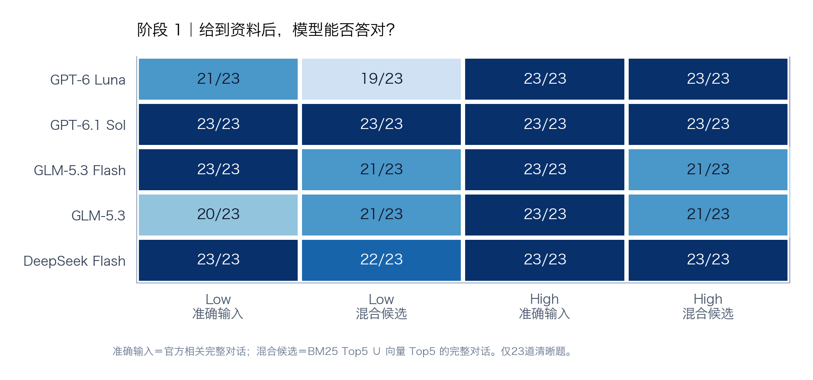
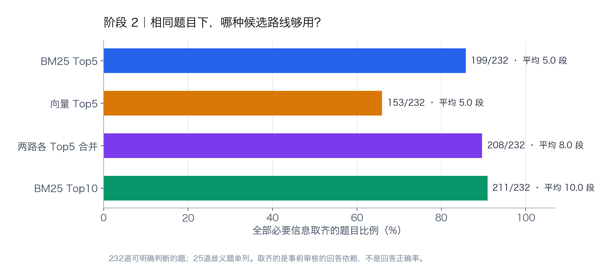
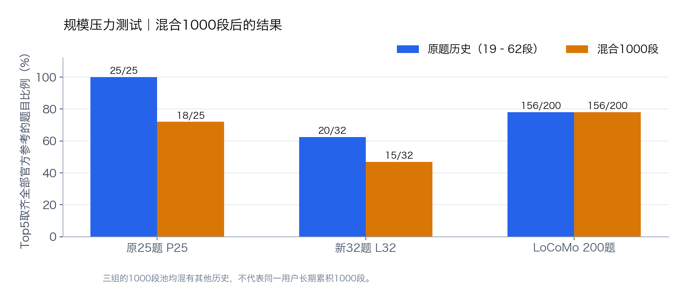
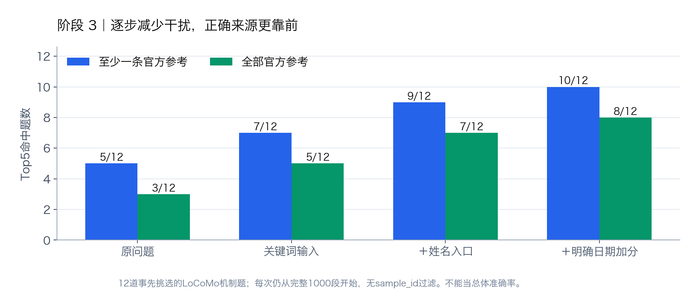

# SMM 检索路线：三个阶段，三个问题

**我们要让 AI 从历史对话中找到依据，再正确回答。** 实验依次问了三件事：资料给对了，模型能答对吗？不靠复杂记忆结构，BM25 能先找回资料吗？对话变多后，怎样减少无关资料干扰？

> **当前决策：以“保留原文＋BM25 候选检索”作为第一阶段底座。** 这是实施路线，不是宣称 BM25 对所有 APP 或全部问题最优。真实 APP 可按可信的用户、权限、时间和业务对象信息逐步限定检索范围；从文字推断人物和事件时要保留不确定性。

## 1. 资料给对了，模型能答对吗？



在原始 **25 题**中，2 题有时间解释歧义，所以答案正确率只按 **23 道清晰题**评分。“准确输入”是官方相关完整对话；“混合候选”是 BM25 Top5 与向量 Top5 合并后的完整对话。High 档准确输入下，五个模型均为 **23/23**；混入候选后，Luna、Sol、DeepSeek 仍为 **23/23**，两种 GLM 为 **21/23**。Low 档结果更分散。模型可在同样包含证据的输入里漏读或误答；检索命中不等于最终答对。[完整输入、输出、评分及模型档位](../../experiments/smm-baseline-001/artifacts/high-effort-comparison-v1/README.md)。

## 2. BM25 能否先承担找原文的工作？



在 **232 道依赖信息可明确审核的题**上，BM25 Top5 取齐全部已标注必要信息 **199/232（85.8%）**；本次使用的向量 Top5 为 **153/232**。合并两路各 Top5 达到 **208/232**，但平均要给后续 Agent **8.0 段**，而 BM25 Top5 只给 **5 段**；BM25 Top10 是 **211/232**。这支持先用 BM25 做简单、可解释的原文候选底座，也如实显示向量有 **9 题净增益**，所以不能把“先上 BM25”理解成“向量永远没用”。另 25 道依赖标注歧义题未计入本图；这里算的是事前审核的来源覆盖，不是回答正确率。[逐题五路线对比](../../analyses/five-candidate-routes-001/README.md)。



**规模是关键反证。** 每题扩充到 1000 段后，原问题 BM25 的 Top5 **全部官方参考对话取齐**从 P25 的 **25/25→18/25**、L32 的 **20/32→15/32**；LoCoMo 的总数保持 **156/200**，但其中有 6 题进步、6 题退步，不能当作逐题稳定。1000 段来自不同题目／不同历史，**不是同一用户连续积累的 1000 条记忆**；此图测试词法干扰，不测真实单用户长期使用。[语料、逐题排名与复算](../../experiments/smm-bm25-scale-1000-002/README.md)。

## 3. 减少干扰，能否让正确来源靠前？



对 **事先挑选的 12 道 LoCoMo 机制题**，每次都从同一批完整 1000 段候选开始：原问题 Top5 至少命中一条／取齐全部官方参考是 **5/12、3/12**；此前写好的关键词输入达到 **7/12、5/12**；加入字面姓名入口是 **9/12、7/12**；再对明确日期加分是 **10/12、8/12**。试验**没有用 `sample_id` 偷缩语料**。姓名多数在这套语料里近乎唯一，日期只在 3 题触发；这说明有针对性的检索条件*可能*帮助排序，尚未证明实体消歧、自动抽取或真实 APP 的总体增益。[协议、逐题数据及失败案例](../../experiments/smm-person-time-1000-pilot-001/REPORT.md)。

反例也要保留：同样的关键词改写在 P25/L32 的 1000 段池中，Top5 全部官方参考取齐分别为 **18→19/25**、**15→13/32**，没有稳定改善；两组也没有题目触发上述明确日期规则。[57题完整复算](../../analyses/bm25-first-stage-synthesis-001/REPORT.md)。

## 怎样把结论用于 APP

```text
原始对话／文档 ──保留原文与来源──> 按可信用户／权限隔离
                                      ↓
Agent 提出检索词 ──> BM25 排序 ──> 候选原文 ──> Agent 核对证据并回答
                           ↑
                 APP 可验证的时间／业务对象信息
```

第一阶段先做身份隔离、原文保存、BM25 检索和可回读的候选展示。个人助手、企业文档、客户协作等 APP 可以在**各自可信的数据边界内**增加日期、对象 ID、文档类型等入口。人物别名、事件归属、事实发生时间等若只能由模型推断，应先作为可追溯、可撤销的辅助入口，避免错误硬过滤把正确原文删掉。库存、日程、Bug 状态的当前值需要业务规则管理，BM25 负责找原文证据，不能取代这些状态系统。

**证据边界：** 阶段 1 是已知的 25 道英语正例；阶段 2 的 232 题是已用过的清晰题，25 道歧义另列；阶段 3 是刻意挑选的 12 题，没有盲测，也没有验证真实用户长期流。官方参考全部取齐与“足以回答”不完全相同；三图的分母与指标不同，不能相加成一个总准确率。下一步若进入实际 APP，应以同一真实或稳定模拟用户的持续事件流验证身份、更新和检索，而不是直接沿用混合 1000 段压力测试的百分比。

图由[绘图脚本](make_charts.py)直接读取公开归档结果生成，同时提供可缩放的 [SVG 图 1](stage1_models.svg)、[图 2](stage2_methods.svg)、[规模图](stage2_scale.svg)、[图 3](stage3_filters.svg)。绘图使用 Python 3.12 和 [Matplotlib 3.10.7](requirements.txt)：安装依赖后运行 `python3 -B reports/three-stage-retrieval-001/make_charts.py`；不调用模型服务。仓库根目录 `python3 -B tools/verify_publication.py` 可复核封存基线。
